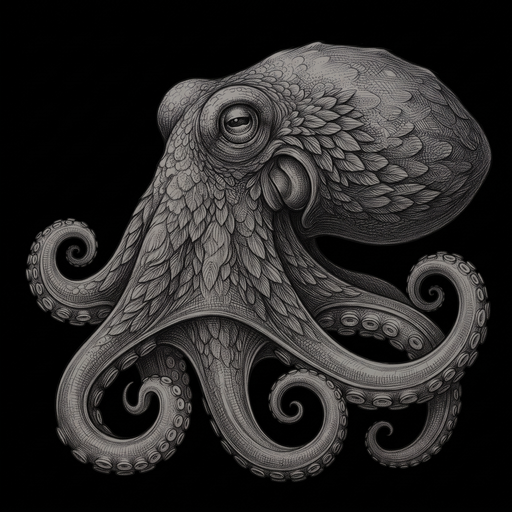

# ActCraft



**Show control for live musicians.** ActCraft plays your multitrack backing tracks and (soon) runs
your stage lighting from one program and one show file, on one shared clock: a song, its audio,
its lyrics and its lighting cues belong together.

Website: [actcraft.org](https://actcraft.org)

Native desktop app for Windows, macOS and Linux, written in Rust. Open source under
`MIT OR Apache-2.0`.

> **Status: early.** Backing-track playback works; lyrics, MIDI and lighting are being built.
> See [ROADMAP.md](ROADMAP.md) for what works today and what comes next.

## What works today

- **Songs and tracks:** add audio files (WAV, AIFF, FLAC, MP3, Ogg, Opus, M4A) with the file
  picker or by dragging them onto the window. Each file becomes a song; add more tracks per song.
  Audio decodes in the background, so the window never freezes.
- **Mixer:** up to 64 tracks per song with volume, pan, 4-band EQ, mute, colour and name; 16 output
  buses; six labelled mute groups; song and master volume.
- **Outputs:** pick your audio interface and route each bus to a pair of outputs
  (Settings > Audio). Tracks choose their bus on their mixer strip.
- **Metronome:** its own bus, audible / count-in only / visual only, per-song count-in, start on
  the beat, latency offset (Settings > Metronome).
- **Tempo:** detected automatically when you add a song, or tap it in, or type it.
- **Library:** search with `AND`, `OR`, `NOT`, `-word`, `title:`, `artist:`, quoted phrases and
  `bpm:>120`; playlists split into sets; smart playlists by rules; a play queue; play history.
- **Transitions:** autoplay to the next song, crossfade, fade-out, song loop.
- **Show files:** everything is saved in one `.actcraft` file; older files keep loading.
- **Remote control:** every action is a command you can run from the command line, from other
  programs over a local JSON channel, or from an AI assistant over MCP.

## Quick start

1. Start ActCraft.
2. Click **Add songs…** (or drag audio files onto the window).
3. Open **Settings** (top right, or `Ctrl+,`) and check your audio interface and outputs.
4. Click a song, press **Play** or the space bar.
5. **File > Save Show** keeps everything in one show file.

## Build from source

You need a Rust toolchain (1.95 or newer).

```sh
cargo run -p actcraft --release --bin actcraft     # the app
cargo run -p actcraft --bin actcraft-cli -- commands
cargo xtask ci                                     # checks to run before every commit
```

On Windows with the GNU/LLVM toolchain and no extra linker installed, the repository's
`.cargo/config.toml` links with the `rust-lld` that Rust ships.

## Remote control

- Command line: `actcraft-cli run song.add '{"title":"Opener","bpm":120}' --show gig.actcraft --save`
- The running app (local port 47380): `actcraft-cli send transport.toggle`
- MCP: `actcraft-cli mcp --automation-read-root DIR --automation-write-root DIR`
  (file access stays inside those folders)

`actcraft-cli commands` lists every command with its parameters.

## Contributing

Read [AGENTS.md](AGENTS.md) first: it holds the house rules and the layout of the code.
`main` changes only through pull requests.

## Licence

`MIT OR Apache-2.0`, at your option: [LICENSE-MIT](LICENSE-MIT), [LICENSE-APACHE](LICENSE-APACHE).
Third-party notes: [ATTRIBUTION.md](ATTRIBUTION.md) and [docs/licences.md](docs/licences.md).
